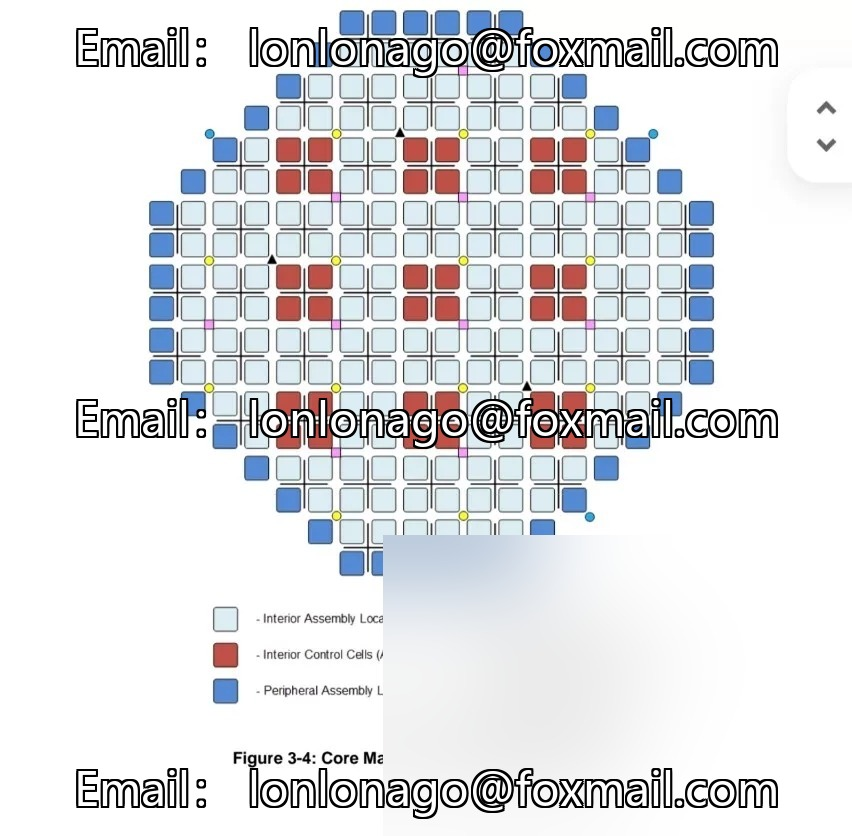
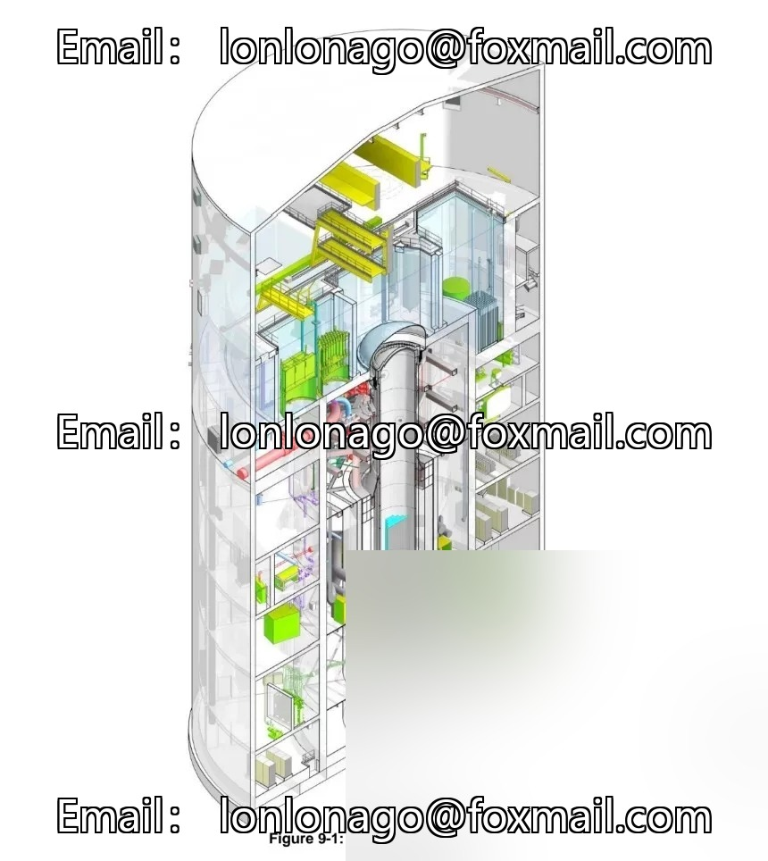
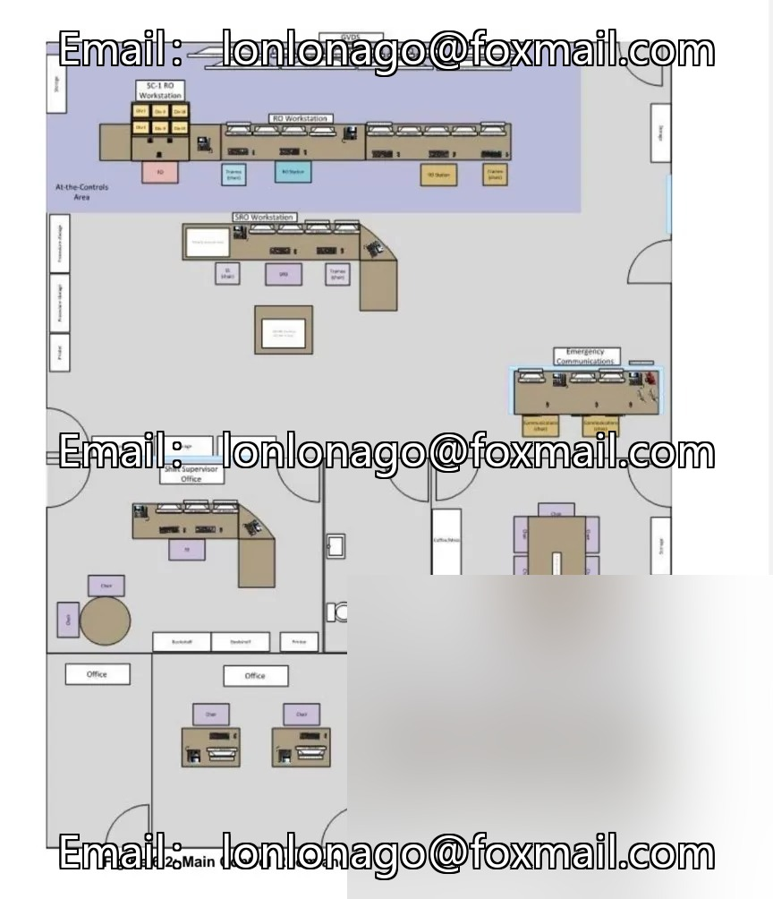

# GE Rihole Nuclear Energy regarding the BWRX-300 small modular nuclear reactor (S)

## Body

GE Riken Nuclear Energy General Design Description Document for BWRX-300 Small Modular Nuclear Reactor (SMR)
PDF file 90 pages

Technology positioning: BWRX-300 is a new-generation small modular reactor (SMR) jointly developed by GE Vernova and Hitachi, and is an offspring of the technological evolution of the 10th generation BWR technology.

Materials cover reactor core layout, control room and surrounding area design, building structure, instrument arrangement, etc., and are suitable for reference for nuclear energy engineering, energy technology, and reactor design related majors.
65563
non-return upon sale upon sale

This is a general design description document for GE HITek on the BWRX-300 small modular nuclear reactor, covering core layout, control room and peripheral area design, building structure and instrument layout; the document is a PDF of 90 pages, with a sales-rejection number of 65563.

<!-- AI_ENRICHED -->

## Images

## Payment

Here is a pay link on Stripe ( https://buy.stripe.com/3cs8yP7sY87d0vu9AB ). Please contact me lonlonago@foxmail.com after funding $89, and I will send you a complete data files , thank you!

